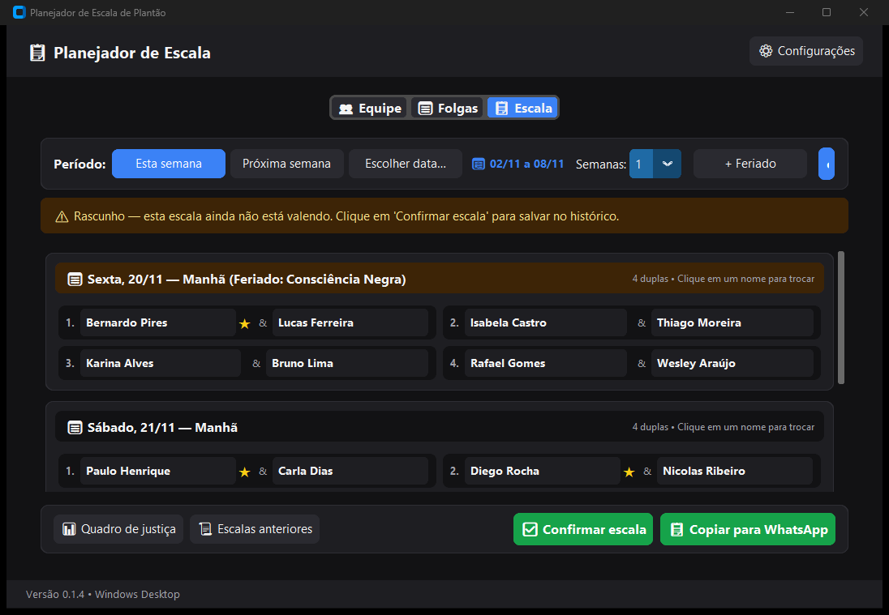
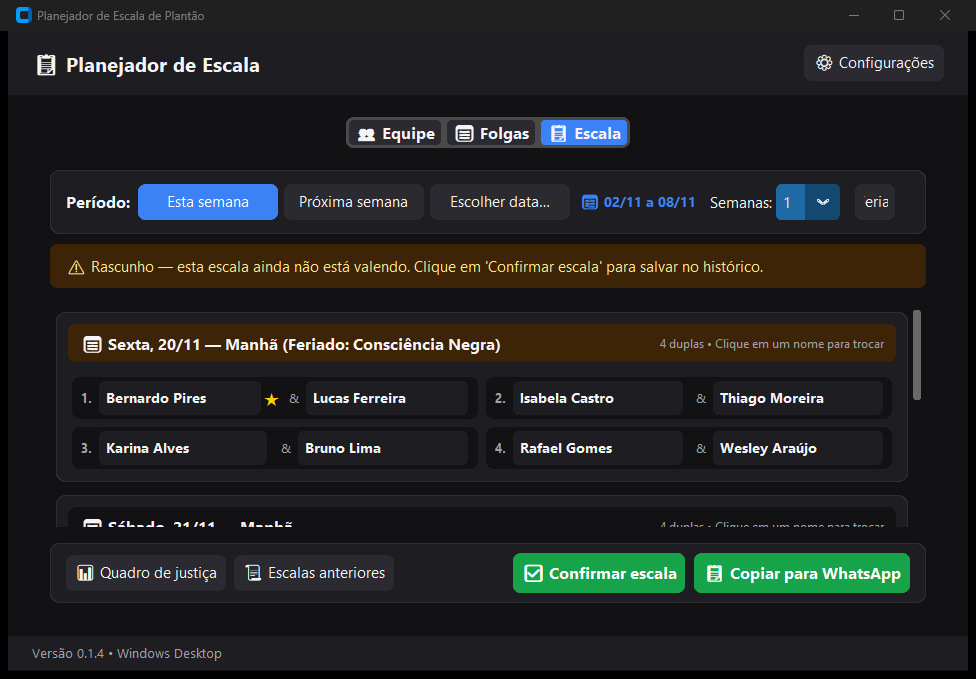
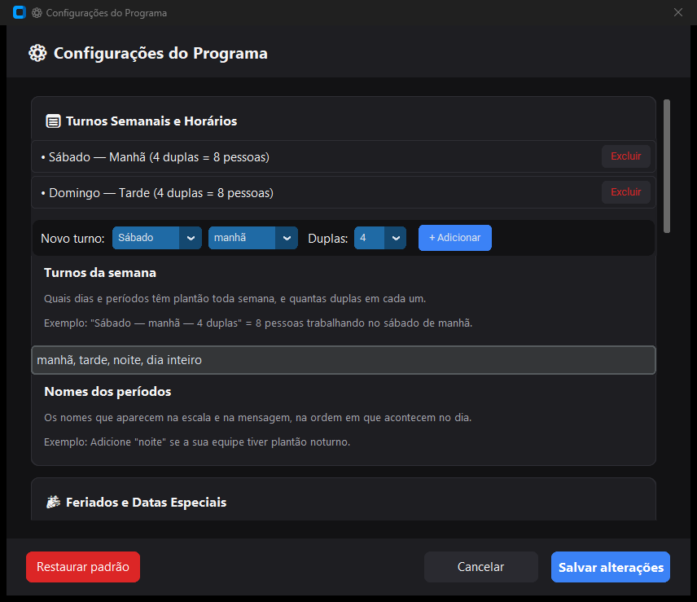

# Revisão de Tech Lead — Planejador de Escala de Plantão (v0.1.4)

> **Data:** 07/11/2026 · **Escopo:** todo o código em `src/`, `tests/`, workflows e documentação.
> **Método:** leitura completa do código + `pytest` (105 testes ✅) + **scripts de verificação** que reproduzem
> os bugs ([verificar_bugs.py](revisao/verificar_bugs.py)) + **capturas de tela reais** do programa rodando com 28 pessoas.

---

## 0. Resumo executivo

O projeto está **bem acima da média para um iniciante**: arquitetura em camadas respeitada na maior parte,
lógica testável e testada, salvamento atômico, recuperação de backup, atualizador com SHA-256, CI/CD funcionando
e documentação didática exemplar (diário, manual, AGENTS.md).

Porém, a revisão encontrou **problemas que impedem o programa de "fazer sua função perfeitamente"**:

| # | Problema | Frente | Gravidade |
|---|---|---|---|
| 1 | O botão **"Gerar escala" não aparece** no tamanho padrão da janela (1080×720) | Visual | 🔴 Crítico |
| 2 | **Pessoa inativa rebaixa o "piso"** → quem volta de férias fica "devendo" plantões (contraria a regra "não compensar") | Lógica | 🔴 Crítico |
| 3 | **Gerar de novo uma semana já confirmada** escolhe outras pessoas e desequilibra a justiça (diferença chega a 2) | Lógica | 🔴 Crítico |
| 4 | Modo de experiência **"Obrigatória" pode gerar dupla sem experiente** | Lógica | 🟠 Alto |
| 5 | Salvar o Quadro de Justiça **"congela" o último plantão** de todos (dado fantasma) | Lógica | 🟠 Alto |
| 6 | Com um rascunho aberto, **não dá para visualizar/editar escalas do histórico** | Lógica (UI) | 🟠 Alto |
| 7 | Depois de restaurar cópia / excluir escala, **edições podem ser perdidas em silêncio** | Lógica (UI) | 🟠 Alto |
| 8 | Abrir o programa **duas vezes** → uma janela apaga as mudanças da outra | Lógica | 🟠 Alto |
| 9 | Backup a cada clique: os 10 backups cobrem só **os últimos 10 cliques** | Eficiência | 🟡 Médio |

Legenda: 🔴 crítico (usuário é afetado no uso normal) · 🟠 alto (afeta em situações comuns) · 🟡 médio · 🟢 baixo/melhoria.

---

## 1. Pontos fortes (manter!)

- **Separação lógica × interface**: `gerador`, `historico`, `edicao`, `exportar` não importam `customtkinter`. Isso é o que permitiu testar o algoritmo sem abrir janelas.
- **Fonte única da verdade** (`calcular_contadores` recalcula tudo das escalas confirmadas): decisão excelente — editar/excluir escala corrige a justiça sozinho.
- **Robustez de dados**: gravação atômica com `os.replace`, backup antes de salvar, recuperação automática do backup mais recente.
- **Reprodutibilidade**: `random.Random(semente)` em vez do `random` global.
- **Mensagens humanas** em quase todos os erros (`"Não há pessoas suficientes no sábado 07/11 (manhã)…"`).
- **Atualizador**: HTTPS obrigatório, SHA-256, silêncio sem internet, testes sem rede (monkeypatch).
- **CI/CD**: tag → testes → confere versão → `.exe` → hash → Release. Profissional.

---

## 2. Frente 1 — Parte visual (UI/UX)

### V1. 🔴 Botão "Gerar escala" cortado no tamanho padrão da janela

**Evidência** (capturas reais; repare na borda direita da barra "Período"):

| 1080×720 (tamanho padrão) | 960×640 (tamanho mínimo) |
|---|---|
|  |  |

No tamanho padrão só aparece uma lasca azul do botão; no mínimo, até o "+ Feriado" é cortado. **A ação principal do
programa fica invisível** — a usuária leiga provavelmente não vai pensar em maximizar a janela.

**Causa** ([tela_escala.py:114-195](../src/escala/interface/tela_escala.py#L114-L195)): 10 widgets numa única linha com `pack(side="left")`.
O `pack` distribui o espaço **na ordem em que os widgets são empacotados**; o "Gerar escala" é o último, então é o primeiro a ser cortado.

**Como melhorar:**
1. Dividir em **duas linhas**: linha 1 = período (3 botões + rótulo de datas); linha 2 = semanas, "+ Feriado" e "Gerar escala".
2. Ou, no mínimo, empacotar o botão principal **primeiro** (`self.btn_gerar.pack(side="right")` antes dos outros), assim ele nunca é cortado.
3. Criar um teste de interface que garante `btn_gerar.winfo_ismapped()` e que `winfo_x() + winfo_width()` cabe na barra em 960×640.

### V2. 🟠 Na janela de Configurações, o controle aparece **acima** do próprio título



A lista de turnos aparece antes do título "Turnos da semana", e o campo de períodos antes de "Nomes dos períodos". A hierarquia
visual fica invertida (o usuário lê a explicação **depois** do campo que ela explica).

**Causa** ([janela_configuracoes.py:155-236](../src/escala/interface/janela_configuracoes.py#L155-L236)): os controles são criados com
`master=cartao`, e não dentro do `CampoComAjuda`. Quando `CampoComAjuda` chama `self.widget.pack(...)`, o widget é empacotado no
**cartão**, antes do próprio `CampoComAjuda`.

**Como melhorar:** passar uma *fábrica* (o `CampoComAjuda` já aceita `callable`):
```python
self.campo_periodos = CampoComAjuda(
    cartao, "periodos",
    widget_controle=lambda pai: ctk.CTkEntry(pai, height=36, font=FONTE_CORPO),
)
self.entry_periodos = self.campo_periodos.widget
```
E, dentro do `CampoComAjuda`, mostrar na ordem **título → explicação → controle → exemplo**.

### V3. 🟠 Pouco espaço útil na aba Escala

Em 1080×720 cabem só **~1,5 plantões** na área de rolagem (ver captura V1). Cabeçalho (65 px) + abas (46) + barra de período +
faixa de rascunho + rodapé de ações + rodapé de versão consomem ~60% da altura.

**Como melhorar:** juntar cabeçalho e abas numa só faixa; mover "Versão 0.1.4" para dentro de Configurações (ou para o título da janela);
deixar a faixa de rascunho mais baixa (1 linha, `pady=4`); considerar 3 colunas de duplas quando a janela for larga.

### V4. 🟠 O rótulo de período não corresponde à escala exibida

O rótulo "📅 02/11 a 08/11" mostra o período **selecionado para gerar**, mas a área abaixo pode exibir outra escala (o rascunho
de outra semana, ou uma escala do histórico). Na captura V1 o rótulo diz 02/11–08/11 e os cartões são de 20/11 e 21/11.

**Como melhorar:** colocar o período **da escala exibida** na faixa de status: *"⚠️ Rascunho de 16/11 a 22/11 — ainda não está valendo…"*
e *"✅ Escala de 09/11 a 15/11 (confirmada)"*.

### V5. 🟡 Janelas de tamanho fixo e não redimensionáveis

[`configurar_janela_modal`](../src/escala/interface/componentes.py#L190-L210) usa `resizable(False, False)` com tamanho fixo:
- `mostrar_erro`/`mostrar_info` (460×200): uma mensagem de 4 linhas já encosta no botão; avisos juntados com `\n` em `_efetivar_troca` serão **cortados**.
- Configurações (840×700 + barra de título ≈ 731 px) **não cabe** num notebook 1366×768 (área útil ≈ 728 px): o botão "Salvar" fica fora da tela.

**Como melhorar:** calcular a altura pelo conteúdo e limitar à tela:
```python
janela.update_idletasks()
altura = min(janela.winfo_reqheight(), janela.winfo_screenheight() - 80)
```
e permitir redimensionar as janelas com listas (Configurações, Justiça, Histórico).

### V6. 🟡 Datas digitadas à mão em 4 lugares, embora exista um calendário

"Escolher data…", "Marcar período (férias)", "Adicionar feriado" e o Quadro de Justiça pedem `dd/mm/aaaa` digitado. Para uma pessoa
leiga, digitar data é a principal fonte de erro. O projeto **já tem** o `CalendarioMensal`.

**Como melhorar:** criar um `SeletorDeData` (campo + botão 📅 que abre o `CalendarioMensal` num popup) e reutilizar. Aceitar também `dd/mm` (assumindo o ano atual), como já é feito em `janela_justica.py`.

### V7. 🟡 Aba Equipe: 56 botões repetidos e ação sem confirmação

Cada cartão tem "Editar" + "Desativar" (28 × 2 = 56 botões iguais) — ruído visual. "Desativar" fica colado em "Editar" e **não pede confirmação**.

**Como melhorar:** cartão inteiro clicável abre o diálogo de edição; mover "Desativar/Reativar" para dentro desse diálogo (com confirmação);
usar o espaço liberado para informação útil (ex.: "3 plantões • 2 folgas futuras"). Adicionar uma legenda "★ = experiente" no topo.

### V8. 🟡 Diálogo de troca pouco orientado

[`_abrir_dialogo_troca`](../src/escala/interface/tela_escala.py#L548-L600) lista as ~20 pessoas em ordem alfabética, cada uma num cartão com borda.
Pessoas que **não podem** ser escolhidas ("já trabalha no dia") aparecem com o mesmo botão "Escolher" e só dão erro depois do clique.

**Como melhorar:** ordenar por adequação (livres e com menos plantões primeiro), **desabilitar** quem já trabalha no dia, mostrar a carga
("2 plantões") e o ★, e adicionar um campo de busca por nome.

### V9. 🟡 Contexto dos botões da aba Escala

- "✅ Confirmar escala" continua ativo ao visualizar uma escala **já confirmada** (só mostra um aviso depois do clique) → desabilitar/ocultar conforme o estado.
- Falta um botão **"Descartar rascunho"**.
- Dois botões verdes lado a lado quebram a regra do próprio design system ("no máximo 1 destaque por grupo"): sugerir "Confirmar" verde e "Copiar" secundário até a escala ser confirmada.

### V10. 🟢 Acessibilidade e consistência

- Fontes abaixo de 14 contrariam a regra do AGENTS.md ("fonte ≥ 14"): cabeçalho "Sáb/Dom" (12), resumo do plantão (12), `FONTE_AJUDA` (13).
- Widgets em Configurações sem tokens do design system (`CTkOptionMenu`, "+ Adicionar" usam a fonte padrão 13) → tamanhos inconsistentes.
- Seletores de pares mostram `"Ana Souza (ID 3)"` — o ID é detalhe técnico; use só o nome (nomes já são únicos).
- Modo escuro fixo: oferecer **modo claro** em Configurações (ambientes muito iluminados / usuários mais velhos leem melhor texto escuro em fundo claro).

### V11. 🟢 Melhorias de produto nas telas

- **Folgas**: a lista "Todas as folgas cadastradas" cresce para sempre (inclui datas passadas, uma linha por dia). Mostrar só as **futuras** e agrupar intervalos: *"01/12 a 20/12 (20 dias)"*. Destacar no calendário os dias que têm plantão.
- **Visão "quem folga nesta semana"** na aba Escala (as 12 pessoas que não foram escaladas) — ajuda muito a responder "quem pode cobrir?".
- **Feriados**: permitir **vários períodos** por feriado (ver L11), editar um feriado e um botão "Sugerir feriados nacionais do ano" (fixos + Carnaval/Sexta-feira Santa/Corpus Christi calculados pela Páscoa).
- **Quadro de Justiça**: mostrar o ano no "Último plantão", explicar a coluna "Observação" e usar `grid` (colunas compartilhadas) em vez de larguras/`padx` ajustados à mão no modo edição.

---

## 3. Frente 2 — Eficiência e otimização de código

> Com 28 pessoas, **desempenho bruto não é problema**: o algoritmo roda em milissegundos. Os pontos abaixo são sobre
> **I/O desnecessário, crescimento ao longo dos anos e complexidade que não se paga**.

### E1. 🟡 Backup completo a cada clique torna os backups inúteis

Toda ação chama `ao_mudar()` → `salvar()` → **cópia de backup + regravação do JSON inteiro**. Marcar 10 dias de folga no calendário
= 10 backups. Como só os 10 mais recentes são mantidos, **se a usuária apagar uma escala por engano e clicar mais 10 vezes, o backup bom já sumiu**.

**Como melhorar** ([armazenamento.py:265-285](../src/escala/armazenamento.py#L265-L285)):
- Fazer backup **no máximo 1 vez por sessão/hora** (ex.: só se o backup mais recente tiver mais de 1 hora) e manter, por exemplo, **os 10 últimos + 1 por dia dos últimos 30 dias**.
- Opcional: *debounce* do salvamento na interface (`after(500, ...)` cancelando o agendamento anterior) para cliques em sequência.

### E2. 🟡 Salvamento "atômico" sem `fsync`

[`_gravar_arquivo_atomico`](../src/escala/armazenamento.py#L241-L247) faz `write` + `os.replace`, mas sem `flush()` + `os.fsync()`.
Numa queda de energia, o Windows pode ter renomeado o arquivo **antes** de gravar o conteúdo no disco → arquivo vazio. (A recuperação
por backup ameniza, mas o objetivo do salvamento atômico é justamente não depender dela.)
```python
with caminho_tmp.open("w", encoding="utf-8") as f:
    f.write(texto)
    f.flush()
    os.fsync(f.fileno())   # garante que os bytes estão no disco antes do replace
os.replace(caminho_tmp, caminho_destino)
```

### E3. 🟡 Dois `RotatingFileHandler` no mesmo `registro.log`

[`main.configurar_logging`](../src/escala/main.py#L13-L38) adiciona um handler ao logger `"escala"` e
[`armazenamento._obter_logger`](../src/escala/armazenamento.py#L46-L60) adiciona **outro** ao filho `"escala.armazenamento"`.
Resultado: mensagens duplicadas e, no Windows, `PermissionError` na rotação (um handler segura o arquivo enquanto o outro tenta renomear).

**Como melhorar:** só `main.py` configura handlers; os módulos usam apenas `logger = logging.getLogger(__name__)`.

### E4. 🟡 Atualizador baixa o `.exe` inteiro na memória e trava a janela

- [`baixar_e_verificar`](../src/escala/atualizador.py#L138-L180) usa `resp_exe.content` (≈ 30 MB em RAM). Use `stream=True` + `iter_content(65536)` gravando em blocos — e já calcule o SHA-256 durante o download.
- [`_oferecer_atualizacao`](../src/escala/interface/janela_principal.py#L214-L232) chama o download **na thread principal**: a janela fica "Não respondendo" por até 60 s sem nenhum aviso. Rodar em `threading.Thread` e mostrar "Baixando atualização…".

### E5. 🟢 Complexidade que não se paga (manutenção > ganho)

- `AbasRapidas` sobrescreve métodos **privados** do `CTkTabview` (`_segmented_button_callback`, `_set_grid_current_tab`, `_current_name`) e `congelar_redesenho` usa Win32 via `ctypes`. Funciona hoje, mas **quebra silenciosamente** numa atualização do CustomTkinter — e o `requirements.txt` **não fixa versões**, então o próximo build da Release pode pegar uma versão nova.
  - **Ação mínima:** fixar versões (`customtkinter==5.2.2`, `requests==2.32.x`) e atualizar de propósito, testando.
  - **Reflexão didática:** medir antes de otimizar. Com 28 pessoas, um `CTkScrollableFrame` simples teria desempenho aceitável; parte dessa engenharia (RotuloSimples, WM_SETREDRAW) pode ser simplificada.
- `copy.deepcopy(calcular_contadores(dados))` em [gerador.py:330](../src/escala/gerador.py#L330): `calcular_contadores` já devolve um objeto novo; o `deepcopy` é desnecessário.
- `custo_do_par` recria `frozenset` de **todos** os pares "nunca juntos" a cada chamada (é chamado O(n³) vezes em `formar_duplas`). Pré-calcular um `set[frozenset]` uma vez por geração.
- `buscar_pessoa` é busca linear e é chamada dentro de laços (exportar, validar, preencher cartões). Um `dict[int, Pessoa]` (`pessoas_por_id`) deixa o código mais claro e O(1).

### E6. 🟢 Listas que crescem sem limite

- **Folgas**: a lista é destruída e recriada a cada clique no calendário e inclui todo o passado (férias de 30 dias = 30 linhas × 3 widgets). Ver V11.
- **Histórico**: um cartão (≈ 7 widgets) por escala, recriado inteiro a cada exclusão — ~100 cartões em 2 anos. Agrupar por mês ou paginar ("mostrar mais").

### E7. 🟢 Build

- `PlanejadorEscala.spec` usa `upx=True` — UPX aumenta falsos positivos de antivírus em `.exe` sem assinatura (já é um ponto sensível no manual). O workflow usa a linha de comando (sem spec); padronizar e desligar UPX.
- `.gitignore` ignora `*.spec` mas o arquivo existe localmente — decidir se ele é a fonte da verdade do build (então versionar) ou apagá-lo.

---

## 4. Frente 3 — Lógica e cumprimento dos requisitos

> Todos os itens marcados com 🧪 foram **reproduzidos** com [verificar_bugs.py](revisao/verificar_bugs.py)
> (`python docs/revisao/verificar_bugs.py`). Saída real:
> ```
> === 1. Pessoa INATIVA rebaixa o piso de quem volta de férias ===
>   inativo=False: carga P01 (voltou)=4, menor carga entre ativos=4, carga P28=4
>   inativo=True: carga P01 (voltou)=2, menor carga entre ativos=4, carga P28=1
> === 2. Regerar uma semana JÁ confirmada escolhe outras pessoas ===
>   pessoas em comum entre original e regerada: 4 de 16
>   cargas após confirmar: min=1 max=3
> === 3. Modo 'obrigatoria' violado por dupla fixa de 2 experientes ===
>   P07 + P08   <-- SEM EXPERIENTE
> === 4. Salvar o Quadro de Justiça 'congela' o último plantão ===
>   P06: ultimo_plantao=2026-01-17 (escala excluída ainda conta)
> ```

### L1. 🔴🧪 Pessoa inativa rebaixa o piso (viola "pessoa que volta de férias não compensa")

A seção 8.1 define *presente* como **pessoa ativa** e disponível. Mas [`esta_presente`](../src/escala/historico.py#L65-L84) **não olha `pessoa.ativo`**,
e [`aplicar_piso_semanal`](../src/escala/historico.py#L87-L109) percorre `dados.pessoas` inteiro. Uma pessoa desativada (com carga parada)
conta como "presente" e vira a **menor carga** da equipe. Quem estava de férias é "empatado" com ela — no teste, voltou com carga 2
enquanto o resto tinha 4 → será escalada **duas semanas seguidas** para "pagar a dívida". É exatamente o que a regra de negócio proíbe.

**Como melhorar:** calcular o piso só entre **ativos** presentes:
```python
presentes = [p for p in dados.pessoas
             if p.ativo and esta_presente(p, dias_com_plantao, dados.configuracao)]
```
(Inativos podem ser tratados como ausentes; ao reativar, `data_entrada` já vira hoje.) Adicionar teste de regressão com o cenário acima.

### L2. 🔴🧪 Gerar de novo uma semana que já tem escala confirmada desequilibra a justiça

[`gerar_escala`](../src/escala/gerador.py#L317-L366) calcula os contadores com **todas** as escalas confirmadas — inclusive a da própria semana
que será substituída. Quem trabalhou nela aparece com `trabalha_nesta_semana=1` e carga +1, então o algoritmo escolhe **as outras pessoas**.
Ao confirmar, a escala antiga é apagada: resultado medido **min=1, max=3** (viola a regra 6, diferença ≤ 1).
O mesmo vale ao gerar uma semana **anterior** a outra já confirmada (o `dias_desde_ultimo_plantao` fica negativo).

**Como melhorar:**
1. Em `gerar_escala`, calcular os contadores **sem** as escalas confirmadas que se sobrepõem ao período (elas serão substituídas):
   ```python
   dados_base = copy.copy(dados)
   datas = {p.data for p in plantoes}
   dados_base.escalas = [e for e in dados.escalas
                         if not datas & {pl.data for pl in e.plantoes}]
   contadores = calcular_contadores(dados_base)
   ```
2. Considerar só escalas **anteriores** ao período (o histórico é cronológico).
3. Na interface, avisar **antes** de gerar: *"Esta semana já tem uma escala confirmada. Gerar uma nova vai substituí-la quando você confirmar."*

### L3. 🟠🧪 Modo "Obrigatória" não é garantido na formação das duplas

[`_garantir_experiencia_obrigatoria`](../src/escala/gerador.py#L223-L255) garante a **quantidade** de experientes escolhidos, mas
[`formar_duplas`](../src/escala/gerador.py#L258-L314) pode desperdiçá-los:
- uma **dupla fixa** de dois experientes consome 2 experientes numa dupla só (reproduzido: `P07 + P08` sem experiente);
- no passo 2, se o melhor par de um experiente é "nunca juntos", o laço faz `break` e os demais experientes vão para o passo 3, onde dupla sem experiente custa só 10 (não infinito).

A regra 5 diz que é **obrigatória** ("nunca violar").

**Como melhorar:** no modo `obrigatoria`, `custo_do_par` deve retornar `inf` para dupla sem experiente; contar experientes já
"gastos" nas duplas fixas ao fazer a troca; e terminar `formar_duplas` com uma verificação que levanta `ErroEscala` amigável se
sobrar dupla sem experiente. `validar_escala` também deveria checar essa regra (hoje não checa).

### L4. 🟠🧪 Salvar o Quadro de Justiça "congela" o último plantão de todos

No modo edição, [`_salvar_edicao`](../src/escala/interface/janela_justica.py#L335-L381) chama `ajustar_contadores_pessoa` para **todas**
as linhas, inclusive as não alteradas, gravando `ultimo_plantao_manual` = último plantão calculado. Se depois uma escala for excluída
(ou corrigida), essa data **continua contando**, e a semana dela entra em `semanas_trabalhadas` → a pessoa é tratada como "já trabalha
nesta semana / trabalhou na semana anterior" por um plantão que não existe mais.

**Como melhorar:** gravar ajuste **somente dos campos que o usuário alterou**; e tratar os valores manuais como "saldo anterior ao uso
do programa" (ex.: ignorar `ultimo_plantao_manual` se houver plantão confirmado depois dele, e não usá-lo para `semanas_trabalhadas`).

### L5. 🟠 Com um rascunho aberto, não dá para ver/editar escalas do histórico

[`TelaEscala.atualizar_tela`](../src/escala/interface/tela_escala.py#L243-L252) começa com
`if self.dados.rascunho is not None: self.escala_ativa = self.dados.rascunho`. Então:
- "Visualizar" no histórico → `_visualizar_escala_historico` → `atualizar_tela()` → volta para o rascunho. **O botão não faz nada.**
- Se a troca for feita numa escala do histórico, `ao_mudar()` faz a tela "pular" de volta para o rascunho.

Isso quebra o requisito *"Editar escala já confirmada (registrar trocas de última hora)"* sempre que existir um rascunho.

**Como melhorar:** guardar **qual** escala está sendo vista (ex.: `self._vendo = "rascunho"` ou o índice no histórico) e só cair no
rascunho quando o usuário gerar uma nova escala. Mostrar na faixa de status um botão "Voltar ao rascunho".

### L6. 🟠 Referências "órfãs" fazem edições serem perdidas em silêncio

As telas guardam **objetos**, não ids:
- `TelaFolgas.pessoa_selecionada` ([tela_folgas.py:176-184](../src/escala/interface/tela_folgas.py#L176-L184)) verifica se o id ainda existe, mas **continua usando o objeto antigo**. Após "Restaurar de uma cópia", `dados.pessoas` tem objetos novos; marcar folgas altera o objeto antigo, que não é salvo.
- `TelaEscala.escala_ativa` continua apontando para uma escala **excluída** no histórico (ou substituída pela restauração): ela segue exibida como "confirmada" e as trocas feitas nela somem.

**Como melhorar:** guardar `id_pessoa_selecionada: int | None` e buscar o objeto em `self.dados` a cada uso; para escalas, guardar o
índice/identificador e revalidar em `atualizar_tela()`. É a aplicação literal da regra 10.1.2 do AGENTS.md ("proibido guardar estado duplicado na tela").

### L7. 🟠 Duas instâncias do programa sobrescrevem os dados uma da outra

Uma pessoa leiga clica duas vezes no atalho com frequência. Cada instância tem seu próprio `DadosDoPrograma` em memória e salva
o arquivo inteiro a cada clique → **a última que salvar apaga o trabalho da outra**.

**Como melhorar:** um *lock* simples em `pasta_de_dados()/programa.lock` (abrir com `msvcrt.locking`, ou um *mutex* nomeado do Windows via `ctypes`).
Se já estiver aberto: *"O Planejador já está aberto em outra janela."* e sair.

### L8. 🟠 Regras de negócio dentro da interface (viola seção 2.3/10.1)

Lógica que deveria estar em `modelos.py`/`edicao.py` (com testes) está nas telas:
- **Editar pessoa** (validação de nome repetido) e **excluir pessoa** em [tela_equipe.py:335-379](../src/escala/interface/tela_equipe.py#L335-L379). Bug consequente: a exclusão só checa escalas **confirmadas** — a pessoa pode estar no **rascunho** e nos pares "nunca juntos"/"duplas fixas", que ficam com ids órfãos ("ID 12" no WhatsApp).
- **Reativar** (`data_entrada = hoje`) em `_alternar_status`.
- **Validação de configuração** (capacidade, turnos, períodos) em `JanelaConfiguracoes._salvar`.
- **Adicionar/remover feriado** (duplicidade de data) em `janela_feriado.py`.

**Como melhorar:** criar `DadosDoPrograma.editar_pessoa(...)`, `remover_pessoa(...)` (limpando rascunho e pares), `alternar_ativo(...)`,
`adicionar_feriado(...)` e `validar_configuracao(config, dados) -> list[str]`, todos com testes. A tela só chama e trata `ErroEscala`.

### L9. 🟡 Inconsistências de configuração

- Remover um período em "Nomes dos períodos" deixa turnos e o padrão de feriado usando um período que não existe mais (o plantão vai para o fim do dia, ordem 999). Validar ou impedir.
- O combo "Semanas" da aba Escala é preenchido só na criação ([tela_escala.py:174](../src/escala/interface/tela_escala.py#L174)): mudar "Semanas por vez" em Configurações **não tem efeito até reiniciar** o programa.
- [`JanelaFeriado`](../src/escala/interface/janela_feriado.py#L83-L106): o combo de período ignora o período do padrão configurado (sempre começa no primeiro da lista), e só permite **um** período por feriado — o requisito diz "usuário escolhe turnos e nº de duplas" (o modelo `Feriado.periodos` já suporta vários).

### L10. 🟡 Fluxo de geração e troca

- "Gerar escala" **substitui o rascunho sem perguntar**, perdendo trocas manuais já feitas nele.
- [`trocar_pessoa`](../src/escala/edicao.py#L14-L64) não avisa quando a troca cria par "nunca juntos" ou dupla sem experiente (modo obrigatória); `validar_escala` também não verifica experiência.
- O botão "Copiar" muda o texto para "✅ Copiado!" e restaura após 2 s lendo o texto **atual**; clicar duas vezes em menos de 2 s deixa o botão **preso em "✅ Copiado!"** para sempre ([tela_escala.py:666-668](../src/escala/interface/tela_escala.py#L666-L668) e [janela_historico.py:179-181](../src/escala/interface/janela_historico.py#L179-L181)). Guardar o texto original numa constante.
- O "Quadro de Justiça" ordena por `(carga, feriados, último plantão)`, enquanto o gerador usa outra chave (semana atual, semana anterior, dias desde o último…). A "fila" mostrada pode não ser a ordem real de escolha → extrair uma função comum em `historico.py` ou explicar a diferença na tela.

### L11. 🟡 Justiça depende de dados que o usuário pode apagar

O piso de ausências usa as `indisponibilidades` **atuais**. Se a usuária "limpar" folgas antigas na aba Folgas (o botão "Remover" aparece
para datas passadas), a justiça do passado é recalculada de outro jeito. **Como melhorar:** esconder/bloquear a remoção de folgas passadas (ou avisar).

### L12. 🟡 Erros de inicialização e atualização

- Se `carregar()` ou a criação da janela falharem, [`iniciar`](../src/escala/main.py#L41-L66) faz `raise` → o PyInstaller mostra um **traceback** (proibido pela seção 2.3). Usar `tkinter.messagebox.showerror` como último recurso antes de sair.
- Se o download da atualização falhar, nada é mostrado (só o erro de permissão é exibido) — a usuária clicou "Sim" e "nada aconteceu". Mostrar *"Não foi possível atualizar agora. Tentaremos na próxima abertura."*
- O `.bat` do atualizador quebra se o caminho do `.exe` tiver `%`, `&` ou `!`; testar também com usuário do Windows com acento (`C:\Users\Conceição\...`).

### L13. 🟢 Processo e testes

- **Faltam testes de regressão** para L1–L6. Cada bug corrigido deve ganhar um teste que falha antes da correção (o script `verificar_bugs.py` é um bom ponto de partida).
- `AGENTS.md` está no `.gitignore`: o documento com **todas as decisões de negócio não está versionado**. Se o computador for perdido, perde-se a especificação. Recomendo versioná-lo (ou mover as decisões para `docs/`).
- A especificação (seção 8.2, regra 6) promete diferença de carga ≤ 1 — vale um teste de propriedade: gerar 20 semanas com folgas aleatórias (sementes fixas) e checar `max - min <= 1` sempre que não houver falta de gente.

---

## 5. Plano de ação sugerido (ordem de prioridade)

| Ordem | Itens | Por quê |
|---|---|---|
| 1 | **V1** (botão Gerar) | Sem isso, a usuária não consegue usar a função principal |
| 2 | **L1, L2, L3** + testes de regressão | Garantem que a escala é justa e respeita as regras obrigatórias |
| 3 | **L5, L6, L4** | Evitam perda silenciosa de edições e dados fantasmas |
| 4 | **L7, E1, E2, E3** | Proteção dos dados (instância única, backups úteis, fsync, log) |
| 5 | **V2, V4, V5, L9, L10** | Clareza e consistência no uso diário |
| 6 | **L8** (mover regras para a lógica) | Dívida técnica — facilita testar e evoluir |
| 7 | **E4, E5, L12**, fixar versões | Robustez do atualizador e do build |
| 8 | **V6–V11, E6, E7, L11, L13** | Polimento e evolução do produto |

> 💡 Sugestão de processo: tratar cada linha da tabela como uma "Fase 12.x" no AGENTS.md, com o mesmo ritual já usado
> (teste que falha → correção → `pytest` verde → diário → commit). Isso mantém o objetivo didático do projeto.
